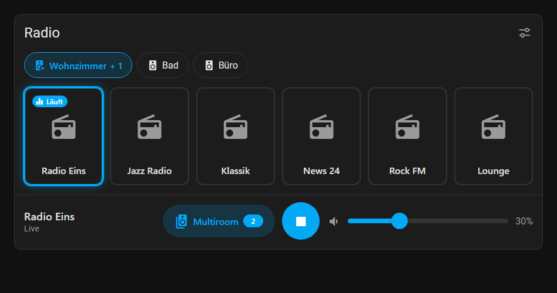
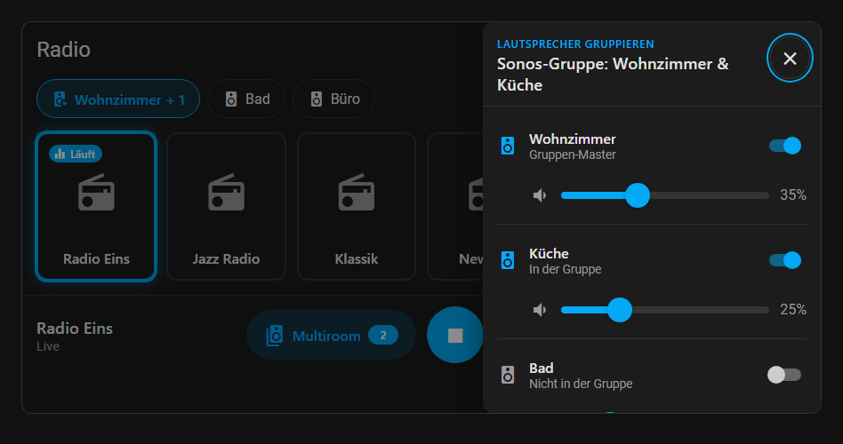

# Sonos Radio Card

A touch-friendly Home Assistant Lovelace card for playing radio stations on
Sonos speakers and managing Sonos multiroom groups. It is configured entirely
through the visual card editor; no extra scripts, helpers or YAML are needed.





## Features

- **Station grid** – responsive tiles with station logo (radio icon fallback)
  and name. The station that is currently playing on the active group is
  highlighted, matched via `media_content_id`, `media_channel` or
  `media_title`.
- **One-tap playback** – tapping a tile calls `media_player.play_media` on the
  current group coordinator, so existing Sonos groups stay intact.
- **Speaker choice** – a chip row above the stations lets you pick which
  configured speaker (or existing group) a station starts on, before playback
  begins.
- **Control bar** – now-playing info with the **Multiroom** button next to it,
  and one large play/stop button next to the group volume slider (keeps
  per-room differences).
- **Group speakers drawer** – slides in from the right and closes by tapping
  outside, the close button, Escape or swiping right. It shows the active
  group (for example “Sonos group: Living Room & Kitchen”), a toggle per room
  (`media_player.join` / `media_player.unjoin`) and a per-room volume slider
  with percentage (`media_player.volume_set`).
- **Settings panel** – a second side panel (small tune button in the top-right corner)
  for quiet hours with a start volume, a maximum volume and shuffle for
  Sonos favorite playlists. See [Settings panel](#settings-panel).
- **Seamless master handoff** – removing the group master hands the group to
  the next available room, so music keeps playing in the remaining rooms.
- **Smooth volume sliders** – slider input is throttled (at most one call
  every 300 ms per slider, one request in flight) and the slider keeps its
  position until Home Assistant reports the new volume, so it does not jump
  back while dragging.
- **Helpful hints** – the card shows notices for missing or unavailable
  speakers, empty station lists, stations without a stream URL or with
  suspicious URLs, streams that fail to start, and failed service calls.
- **Comfortable editor** – pick Sonos favorites from a list, search
  [Radio Browser](https://www.radio-browser.info/) for stations (stream URL
  and logo are filled in automatically) and choose logos with the Home
  Assistant media browser.
- **German and English** – the card and the editor follow the language of
  the Home Assistant user profile (English is the fallback).
- **Sections view ready** – sensible default size in the sections layout
  (full width, at least half width) and a matching card size in masonry
  views.
- **Accessible** – large touch targets, keyboard focus stays inside the open
  drawer, screen readers ignore the card behind it, and animations are
  turned off when the system asks for reduced motion.
- **Instant feedback** – room toggles switch immediately while Sonos
  regroups (this often takes one or two seconds) and switch back with an
  error message if the speaker does not respond.
- Uses Home Assistant theme variables (`--ha-card-background`,
  `--primary-color`, `--ha-card-border-radius`, …) and native HA editor
  components.

## Requirements

- Home Assistant with the [Sonos integration](https://www.home-assistant.io/integrations/sonos/)
  set up. Each Sonos speaker is a `media_player` entity.
- For HACS installation: [HACS](https://www.hacs.xyz/) installed.

## Installation

### HACS (custom repository)

1. Open **HACS** in Home Assistant.
2. Open the menu (⋮, top right) and select **Custom repositories**.
3. Enter the URL of this repository, select the type **Dashboard** and select
   **Add**.
4. Search for **Sonos Radio Card**, open it and select **Download**.
5. Reload your browser (on tablets, also clear the app cache or restart the
   Companion app).

HACS adds the dashboard resource automatically. If you manage resources in
YAML mode, add it yourself:

```yaml
lovelace:
  resources:
    - url: /hacsfiles/sonos-radio-card/sonos-radio-card.js
      type: module
```

### Manual installation

1. Download `sonos-radio-card.js` from the latest release, or build it
   yourself (see [Development](#development)); the file is written to
   `dist/sonos-radio-card.js`.
2. Copy the file to `/config/www/sonos-radio-card.js` on your Home Assistant
   host (create the `www` folder if it does not exist and restart Home
   Assistant once afterwards).
3. Enable **Advanced mode** in your user profile.
4. Go to **Settings → Dashboards → ⋮ → Resources → Add resource** and enter:
   - URL: `/local/sonos-radio-card.js?v=0.1.0`
   - Resource type: **JavaScript module**
5. Hard-refresh the browser (Ctrl+F5 / Cmd+Shift+R).

Increase the `?v=` value whenever you replace the file, so browsers and the
Companion app load the new version instead of a cached one.

## Configuration

Edit a dashboard, select **Add card** and choose **Sonos Radio Card**. The
visual editor has two sections:

1. **General & speakers** – optional title, optional default master speaker
   and a sortable list of Sonos speakers with an optional display name and
   icon per room.
2. **Radio stations** – a sortable list of stations with name, type, stream
   URL or Sonos favorite ID, and logo. Helpers in this section:
   - **Sonos favorite picker** – for the type **Sonos favorite**, the editor
     lists the favorites of your speakers in a dropdown. Selecting one sets
     the favorite ID and, if still empty, the name and logo.
   - **Search Radio Browser** – enter a station name and select **Add** next
     to a result. The station is added with its stream URL (type `music`)
     and logo. Only the search term is sent to the public
     [radio-browser.info](https://www.radio-browser.info/) API, directly from
     your browser.
   - **Choose logo** – the image button next to the logo field opens the Home
     Assistant media browser. Pick an image, for example from **My media**;
     the card stores it as a `media-source://` URI.

### Options

| Option          | Type   | Required | Description                                                                                                          |
| --------------- | ------ | -------- | -------------------------------------------------------------------------------------------------------------------- |
| `type`          | string | Yes      | `custom:sonos-radio-card`                                                                                            |
| `title`         | string | No       | Card title.                                                                                                          |
| `master_entity` | string | No       | Preferred speaker for playback. If omitted or unavailable, the coordinator of the active group is detected automatically. |
| `speakers`      | list   | Yes      | Sonos speakers shown in the group drawer (see below).                                                               |
| `stations`      | list   | Yes      | Radio stations shown in the grid (may be empty, see below).                                                          |

**Speaker**

| Option   | Type   | Required | Description                                       |
| -------- | ------ | -------- | ------------------------------------------------- |
| `entity` | string | Yes      | `media_player` entity of the Sonos speaker.        |
| `name`   | string | No       | Display name; defaults to the entity's name.      |
| `icon`   | string | No       | Icon, for example `mdi:speaker`.                  |

**Station**

| Option               | Type   | Required | Description                                                                                 |
| -------------------- | ------ | -------- | ------------------------------------------------------------------------------------------- |
| `name`               | string | Yes      | Station name.                                                                               |
| `media_content_id`   | string | Yes      | Stream URL or Sonos favorite ID.                                                            |
| `media_content_type` | string | No       | `music` (stream URL, default) or `favorite_item_id` (Sonos favorite).                       |
| `logo`               | string | No       | Image URL (`https://…`, `/local/…`) or Home Assistant `media-source://` URI.               |

### Full example

```yaml
type: custom:sonos-radio-card
title: Radio
master_entity: media_player.living_room
speakers:
  - entity: media_player.living_room
    name: Living Room
    icon: mdi:sofa
  - entity: media_player.kitchen
    name: Kitchen
    icon: mdi:silverware-fork-knife
  - entity: media_player.office
stations:
  - name: Example FM
    media_content_id: https://stream.example.com/example-fm.mp3
    media_content_type: music
    logo: https://stream.example.com/logos/example-fm.png
  - name: Example Jazz (HLS)
    media_content_id: https://stream.example.com/jazz/playlist.m3u8
    media_content_type: music
    logo: /local/logos/jazz.png
  - name: My Sonos Favorite
    media_content_id: "FV:2/12"
    media_content_type: favorite_item_id
    logo: media-source://media_source/local/logos/favorite.png
```

All URLs and IDs above are placeholders – replace them with your own.

## Stream URLs

Use the type **Stream URL** (`media_content_type: music`) and paste a direct
stream URL:

```yaml
- name: Example FM
  media_content_id: https://stream.example.com/example-fm.mp3
  media_content_type: music
```

Tips:

- Sonos plays **MP3**, **AAC** and **HLS** (`.m3u8`) streams. Prefer direct
  stream URLs over web player pages or `.pls`/`.m3u` playlist files.
- Prefer `https://` URLs. The Sonos speaker itself must be able to reach the
  URL, which matters for local or firewalled streams.
- [Radio Browser](https://www.radio-browser.info/) lists stream URLs for
  thousands of stations. Copy the station's stream URL (not the homepage) into
  the card.
- Sonos-specific URIs such as `x-rincon-mp3radio://…` also work.
- Test a URL first with **Developer tools → Actions** using
  `media_player.play_media` on one speaker.

## Sonos favorites

Stations saved as favorites in the Sonos app (for example from TuneIn or
Sonos Radio) can be used directly. Select the type **Sonos favorite**
(`media_content_type: favorite_item_id`) and pick the favorite from the
dropdown in the editor. The editor reads the favorites through the Home
Assistant media browser of your Sonos speakers and falls back to
`sensor.sonos_favorites`. Select the refresh button after adding new
favorites in the Sonos app. In YAML, use the favorite's ID, for example
`FV:2/12`:

```yaml
- name: My Sonos Favorite
  media_content_id: "FV:2/12"
  media_content_type: favorite_item_id
```

To find the ID by hand:

1. Go to **Settings → Devices & services → Sonos → Entities** and enable the
   `sensor.sonos_favorites` entity (it is disabled by default).
2. Open **Developer tools → States** and select `sensor.sonos_favorites`. The
   `items` attribute maps each favorite ID (for example `FV:2/12`) to its name.

Alternatively, use **Developer tools → Template**:

```jinja

{{ id }}: {{ name }}

```

## Logos

`logo` accepts:

- an absolute image URL, for example `https://stream.example.com/logo.png`,
- a file served by Home Assistant, for example `/local/logos/example.png`
  (stored as `/config/www/logos/example.png`),
- a media-source URI, for example
  `media-source://media_source/local/logos/example.png`, which the card
  resolves through Home Assistant.

In the editor, the image button next to the logo field lets you pick an image
from the Home Assistant media browser instead of typing the path. Stations
added from the Radio Browser search use the station's logo URL.

If a logo is missing or fails to load, a radio icon is shown instead.

## Multiroom behavior

- The **group coordinator** is the first entry of the `group_members`
  attribute. Stations are always started on the coordinator, so all grouped
  rooms play along.
- The speaker chips above the stations list every configured speaker that is not part of
  another group, plus one chip per existing group. The chip row is hidden when
  there is only one choice. The default selection is `master_entity` or the
  auto-detected coordinator; picking a chip changes the target until the card
  is reloaded. Unavailable speakers are shown disabled.
- Turning a room **on** in the drawer joins it to the active group; turning it
  **off** removes it.
- Turning off the **current master** hands the group over to the next
  available room in configured order. The remaining rooms are rejoined to the
  new master and the previous station is restarted there if playback stopped.
- The last room of a group cannot be switched off; use **Stop** instead.
- The group volume slider shifts all members together and keeps their
  relative differences.

## Settings panel

The small tune button (<code>mdi:tune-variant</code>) in the top-right corner of the card opens a
settings panel that slides in like the group drawer. Changes are saved
immediately, no YAML or dashboard edit mode is needed.

| Setting            | Effect |
| ------------------ | ------ |
| Maximum volume     | Upper limit (10–100 %) for the group and room sliders. When playback is started from the card, louder speakers are turned down to this limit first. |
| Quiet hours        | Any number of daily time windows (for example 22:00–07:00) with a start volume. When playback is started from the card during a window, all speakers of the group are set to that volume first. Windows may span midnight; equal start and end times mean the whole day. The quietest window wins when they overlap. While quiet hours are active the tune button shows a moon icon. |
| Shuffle playlists  | Sets `media_player.shuffle_set` after starting a Sonos favorite (`favorite_item_id`), a `playlist` or a Spotify URI, so playlists start shuffled (on) or in order (off). Radio streams are not affected. |

Notes:

- Quiet hours and the maximum volume are applied by the card when **you
  start playback from the card** (station tile, play button or joining a
  room). They are not enforced when playback is started elsewhere, for
  example in the Sonos app.
- Times use the clock of the device that shows the card.
- The settings are stored in your Home Assistant **user profile**
  (`frontend/set_user_data`, key `sonos-radio-card`), so they follow your
  user across devices and apply to every Sonos Radio Card. A copy is kept in
  the browser's local storage as a fallback. Different Home Assistant users
  (for example a dedicated wall-tablet user) have their own settings.

## Troubleshooting

| Notice / symptom                                     | Meaning and fix                                                                                                       |
| ---------------------------------------------------- | --------------------------------------------------------------------------------------------------------------------- |
| “No Sonos speakers configured”                       | Add at least one Sonos speaker in the card editor.                                                                    |
| “… is not a media player” / “… was not found”         | The entity ID is wrong or the entity was removed. Pick the speaker again in the editor.                               |
| “… is unavailable” / “All Sonos speakers are unavailable” | The speaker is offline. Check power and network, and the Sonos integration in Home Assistant.                    |
| “Default speaker … is unavailable, using … instead” | The configured master is offline; the card temporarily uses another speaker.                                          |
| “No radio stations yet”                              | Add stations in the card editor.                                                                                      |
| Tile badge “Not set up”                              | The station has no stream URL or favorite ID.                                                                         |
| Tile badge “Check URL”                               | The stream URL looks invalid (spaces, missing `https://`, or a URL entered as a Sonos favorite).                           |
| “… did not start”                                    | Nothing was playing 10 s after tapping. Check that the stream URL is reachable from the speaker and is MP3, AAC or HLS. |
| “Unknown stream” in the control bar                  | The group plays something that is not in your station list.                                                           |
| Card does not appear / old version is shown          | Check the dashboard resource, then hard-refresh or increase the `?v=` value. The browser console (F12) shows the loaded version, for example `SONOS-RADIO-CARD 0.1.0`. |
| “No Sonos favorites found” in the editor             | Save favorites in the Sonos app, then select the refresh button. Check that the speakers are available.               |
| Radio Browser search fails                           | The browser cannot reach radio-browser.info (for example in a restricted network). Enter the stream URL by hand.      |

Sonos speakers must be able to reach Home Assistant on TCP port 1400 for
instant state updates; otherwise the integration falls back to slower
polling and the card updates with a delay. See the
[Sonos integration network requirements](https://www.home-assistant.io/integrations/sonos/#network-requirements).

## Development

Requires Node.js 22 or newer.

```sh
npm install
npm run lint       # ESLint (TypeScript + Lit rules)
npm run typecheck  # TypeScript checks for sources and tests
npm test           # unit tests (node:test)
npm run test:browser  # component tests in Chrome (@web/test-runner)
npm run build      # creates dist/sonos-radio-card.js
```

The component tests need Chrome or another Chromium browser. To use
Microsoft Edge, set `CHROME_PATH` first, for example in PowerShell:

```powershell
$env:CHROME_PATH = "C:\Program Files (x86)\Microsoft\Edge\Application\msedge.exe"
npm run test:browser
```

Source layout:

- `src/sonos-radio-card.ts` – the card (UI, service calls)
- `src/editor.ts` – the visual editor
- `src/sonos.ts` – group, station and notice logic
- `src/volume.ts` – volume slider throttling
- `src/types.ts` – configuration types
- `src/localize.ts` – English and German texts
- `src/media.ts` – Sonos favorites and media browser helpers
- `src/radio-browser.ts` – Radio Browser search
- `test/` – unit tests; `test/browser/` – component tests

`hacs.json` points HACS to `sonos-radio-card.js` in the `dist` folder. Commit
the rebuilt `dist/sonos-radio-card.js` together with source changes; CI fails
if it is out of date.

### Continuous integration and releases

GitHub Actions workflows in `.github/workflows/`:

- **CI** (`ci.yml`) – on every push to `main` and every pull request: lint,
  typecheck, unit tests, component tests and build. The bundle is uploaded as
  a workflow artifact.
- **Validate** (`validate.yml`) – runs the official
  [HACS action](https://github.com/hacs/action) weekly, on pushes and on pull
  requests. HACS requires a public GitHub repository with a description,
  topics and issues enabled.
- **Release** (`release.yml`) – on tags such as `v0.2.0`: checks that the tag
  matches the `package.json` version, runs all checks, builds and creates a
  GitHub release with `sonos-radio-card.js` attached.

To release a new version:

```sh
npm version 0.2.0 --no-git-tag-version
npm run build
git commit -am "chore: release 0.2.0"
git tag v0.2.0
git push origin main v0.2.0
```

## License

[MIT](LICENSE)
